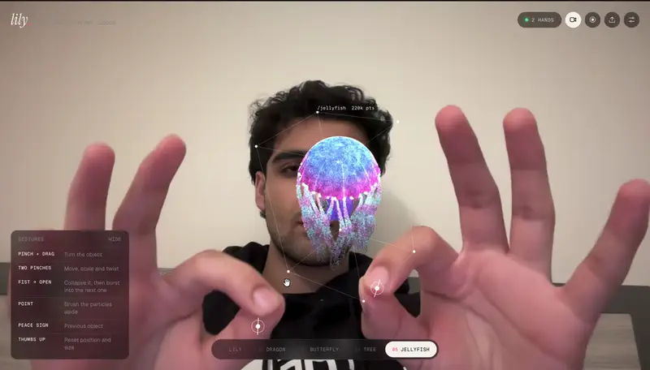

# lily.

[](https://github.com/malikcodeseverything/lily/actions/workflows/ci.yml)

**[Live demo](#deploying)** · TypeScript · Three.js · WebGL (GLSL) · MediaPipe



**Sculpt glowing 3D point clouds in mid-air with your hands.** Real-time hand tracking in the browser drives a GPU particle system: pinch to turn an object, pull it bigger with two hands, crush it into a ball of light with your fist, and open your hand to let it bloom into the next one.

No install, no server. Everything (camera, hand tracking, rendering) runs locally in the browser.


## Features

- **Hand tracking at camera frame rate** using MediaPipe's gesture recognizer (GPU delegate, CPU fallback), smoothed with One Euro filters and debounced so gestures do not flicker.
- **Seven procedural sculptures**, each generated in code from scratch: a stargazer lily, a rearing red dragon, a blue morpho butterfly, a branching tree, a bioluminescent jellyfish, a swimming koi and a spiral galaxy. Each one is 70k to 220k colored, lit points with its own idle animation (flapping, swaying, pulsing, rotating, swimming).
- **Four render styles** you can switch between live: natural, hologram, thermal and ember.
- **GPU morphing.** Two shape slots share one geometry. Every transition, dissolve, collapse and fingertip interaction happens in the vertex shader, so the CPU only touches buffers when a new shape loads.
- **A bounding-box gizmo** that tracks the object, with a viewport-style caption.
- **Bring your own scans.** Drag in a `.ply` (plain point cloud or 3D Gaussian Splatting output), a `.splat`, or a `.glb` mesh. Splats are decoded (spherical harmonic color, logit opacity, log scale), floaters are cropped, and meshes are surface-sampled with their textures.
- **Two recording modes**, saved as MP4 or WebM:
  - **Clean**: webcam, particles and the box, no interface. Made for reels.
  - **Full screen**: everything you see, including the HUD, hand cursors and labels, with no screen-share prompt.
- **Mouse and touch fallback** for when there is no camera.

## Gestures

| Gesture | Action |
| --- | --- |
| Pinch and drag (one hand) | Rotate the object. Let go mid-drag to throw it into a spin. |
| Pinch with both hands | Move, scale and twist the object. |
| Fist, then open your hand | Collapse the object into a glowing core, then burst into the next one. |
| Point | Your fingertip pushes particles aside. |
| Peace sign (hold) | Previous object. |
| Thumbs up (hold) | Reset position and size. |
| Swipe (open hand, quick sideways flick) | Next object (left) or previous (right). |
| Both palms open, pull apart | Stretch the object apart; bring your hands back to reform it. |
| Rock sign 🤘 (hold) | Cycle render style. |
| Thumbs down (hold) | Pause or resume the motion. |

## Mouse and keyboard

| Input | Action |
| --- | --- |
| Drag | Rotate (release while moving to throw) |
| Shift + drag, or right drag | Move |
| Scroll, or two-finger pinch on touch | Scale |
| Hover | Disturb the particles |
| Hold `F`, release | Collapse, then burst into the next object |
| `Space`, `→` / `←`, `1`-`9` | Switch objects |
| `C` | Camera on / off |
| `R` / `Shift+R` | Start a clean / full-screen recording, press again to stop |
| `B` `G` `H` `M` | Toggle box, glow, hand skeleton, mirror |
| `0` | Reset the view |
| Hold `X` | Stretch the object apart |
| `S` / `P` | Cycle render style / pause motion |

## Getting started

```bash
npm install
npm run dev
```

Open the printed **Local** URL (`http://localhost:5173`) and click **Enable camera**. Browsers only allow the camera on `localhost` or HTTPS, so the **Network** address (`http://192.168...`) will not work over plain HTTP.

To try it on a phone on the same Wi-Fi, run the HTTPS dev server and open its Network address (accept the self-signed certificate warning once):

```bash
npm run dev:https
```

If the camera still fails, the welcome screen shows the exact reason (permission, camera in use by another app, no device) and how to fix it.

The hand model (a few MB) is fetched from Google's MediaPipe CDN on first use. To run fully offline, download it once:

```bash
npm run fetch-models
```

### URL options

| Param | Example | Effect |
| --- | --- | --- |
| `q` | `?q=high` | Particle density: `low` (70k), `medium` (140k), `high` (220k). Defaults by device. |
| `shape` | `?shape=dragon` | Starting object: `lily`, `dragon`, `butterfly`, `tree`, `jellyfish`, `koi`, `galaxy`. |
| `box`, `glow`, `mirror` | `?box=0` | Turn a feature off at startup. |
| `debug` | `?debug` | FPS, inference time and live gesture features. |

## How it works

```
webcam ──► MediaPipe GestureRecognizer ──► HandSlots ──────► HandController ──► ObjectTransform
           (21 landmarks + canned          (identity,         (pinch, two-hand,   (damped, inertia,
            gesture scores per hand)        One Euro,          fist→open, point,   idle spin)
                                            classify)          holds)                 │
                                                                   │                  ▼
                                                     MorphDirector + FingerField ──► ParticleCloud (vertex shader)
                                                                                      ▲
                                    ShapeLibrary ── Web Worker builds procedural shapes ┘
```

**Gesture recognition.** MediaPipe's canned classifier knows open palm, fist, pointing, victory and thumbs up, but not pinch, which is the most important gesture here. `src/tracking/gestures.ts` computes scale-invariant features (thumb-to-index distance over hand size, and each finger's tip-to-wrist over knuckle-to-wrist ratio), classifies from geometry, and uses the model's label as a tie breaker. A fist is checked before a pinch because a closed hand often rests the thumb on the index finger. Hysteresis on the thresholds plus a short frame debounce keep labels stable. Thumbs up and down look like a fist to pure geometry, so a confident model label wins for those. Hold gestures fire once per hold, and swipes are detected on the raw (unsmoothed) palm position because the filter's lag would otherwise eat the flick.

**Smoothing.** Each of the 63 landmark coordinates runs through a One Euro filter: heavy smoothing when a hand is still, light smoothing when it moves fast. Classification uses the raw landmarks, so gestures are not delayed by the filter.

**Morphing.** Each particle has a position, color, normal, size and animation parameter in slot A and again in slot B. `uMorph` blends between them with a per-particle stagger, and in the middle of the trip every particle drifts through a simplex noise field and spirals outward, which produces the dissolve. The director always writes the next shape into whichever slot is off screen.

**Shapes.** Generators in `src/shapes/` build surfaces procedurally (recurved petals with Worley-noise freckles, Catmull-Rom tube bodies, scalloped bat-wing membranes, recursive branches with foliage clumps) and then resample to exactly the renderer's point budget. Wings are two-sided: each face is marked one-sided and culled when it faces away, so the butterfly is iridescent blue on top and brown with eyespots underneath, like a real morpho.

**Rendering.** The webcam is a regular `<video>` element with CSS `object-fit: cover` under a transparent WebGL canvas, so the browser keeps its aspect ratio correct everywhere (camera frames uploaded as WebGL textures can come out stretched in Safari). Particles render twice: an opaque, depth-tested pass and an additive halo pass over a subset of points for glow. The recorder composites the video and the canvas onto an offscreen 2D canvas right after each render and records that. Full-screen mode also draws the 2D overlay and repaints the HUD with a small DOM-to-canvas painter (`src/recording/domPainter.ts`) that lays text out word by word at the positions the browser computed, so recording the interface needs no screen-share permission and works the same in every browser.

## Importing your own objects

Capture something with Polycam, Luma, Scaniverse or Postshot and export a Gaussian splat `.ply`, then drag it onto the page. Plain point-cloud PLYs (ASCII or binary, with or without colors) and `.glb` meshes work too. Splats trained from COLMAP scenes are usually upside down, so they are flipped automatically.

## Project structure

```
src/
  app.ts                 renderer, scene graph, frame loop
  main.ts                wires tracking, controllers, HUD and shortcuts
  config.ts              quality presets and URL options
  core/                  seeded RNG, simplex/Worley noise, math helpers
  shapes/                procedural generators, resampling, worker, library
  render/                particle cloud + shaders, webcam background, box gizmo, 2D overlay
  tracking/              MediaPipe wrapper, One Euro filter, gesture classifier, hand identity
  interaction/           hand and pointer controllers, transform, morph director
  io/                    PLY, .splat and glTF importers
  recording/             canvas recorder
  ui/                    HUD, styles, icons
tests/                   Vitest unit tests
scripts/                 copies the MediaPipe wasm into public/, optional model download
```

## Scripts

| Command | What it does |
| --- | --- |
| `npm run dev` | Dev server with hot reload |
| `npm run dev:https` | Same, over HTTPS so phones can use their camera |
| `npm run build` | Type-check and build to `dist/` |
| `npm run preview` | Serve the production build |
| `npm test` | Run the unit tests |
| `npm run fetch-models` | Download the hand model for offline use |

## Deploying

`npm run build` outputs a static site in `dist/` that works from any static host (Vercel, Netlify, Cloudflare Pages, GitHub Pages). The build uses relative asset paths, so it also works from a subfolder.

## Performance notes

- On integrated GPUs, `?q=low` keeps things at 60 fps. Discrete GPUs handle `?q=high` comfortably.
- Hand inference runs on the GPU delegate when available, and only when the camera delivers a new frame. Run with `?debug` to see the per-frame inference time on your machine.
- Shape generation happens in a Web Worker and is cached, so switching objects never stalls the render loop.

## Credits

- [MediaPipe](https://developers.google.com/mediapipe) for hand landmarks and gesture classification
- [three.js](https://threejs.org) for WebGL plumbing
- Simplex noise GLSL adapted from [webgl-noise](https://github.com/ashima/webgl-noise) (MIT)
- One Euro filter after Casiez, Roussel and Vogel, CHI 2012

## License

MIT
